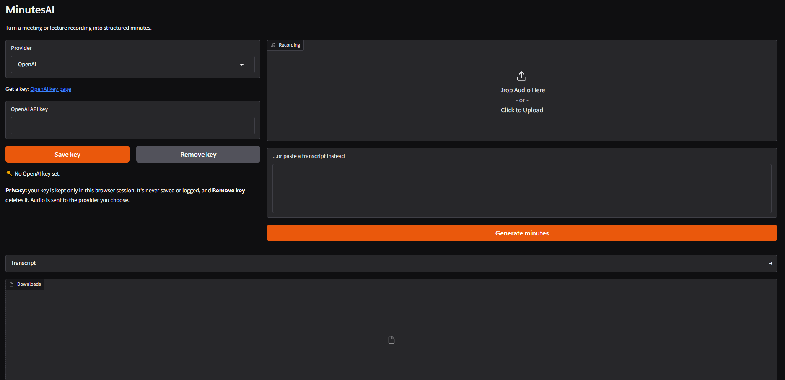
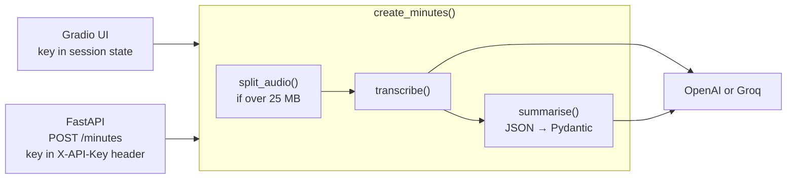

# MinutesAI

[](https://github.com/Krishna-yadu-048/minutesai/actions/workflows/ci.yml)


Turn a meeting or lecture recording into structured minutes: summary, attendees, discussion points, decisions and action items with owners.

Bring your own API key: use **OpenAI**, or **open-source models on Groq** (Whisper for speech-to-text, GPT-OSS for the minutes). No GPU needed.



## Features

- **Bring your own key:** keys are kept only in your browser session, validated before use, and removable at any time
- **Two providers:** OpenAI, or open-source models via Groq
- **Any length of recording:** files over 25 MB are split into 10-minute chunks automatically
- **Structured output:** minutes are JSON validated with Pydantic, with an automatic retry if the model's reply is malformed
- **Web UI and REST API** on one server: Gradio for people, FastAPI for programs
- **Tested:** 18 pytest tests with mocked APIs, plus Ruff, run on every push by GitHub Actions

## How it works



Both the UI and the API call the same `create_minutes()` function, so there's one pipeline to maintain.

| Provider | Speech-to-text | Minutes | Open source |
| --- | --- | --- | --- |
| OpenAI | `gpt-4o-mini-transcribe` | `gpt-4.1-mini` | No |
| Groq | `whisper-large-v3-turbo` | `openai/gpt-oss-120b` | Yes (open weights) |

Model names live in `src/minutesai/config.py`, so a retired model is a one-line change.

## Design decisions

- **One pipeline, two interfaces.** The Gradio UI and the FastAPI endpoint both call
  `create_minutes()`, so there's no duplicated logic to keep in sync.
- **Bring-your-own key.** Keys live in per-session state (UI) or a request header (API)
  and are never stored or logged, so the app can be shared without spending my quota.
- **Structured output over free text.** The LLM returns JSON validated by Pydantic, with
  one automatic retry, so output is consistent across providers and safe for the API.
- **Providers in config, not code.** When Groq retired `llama-3.3-70b-versatile` during
  development, switching to `gpt-oss-120b` was a one-line change.
- **Tests without API calls.** All provider calls are mocked, so CI runs free and fast
  and never needs real keys.


## Quick start

Requirements: [uv](https://docs.astral.sh/uv/) and [ffmpeg](https://ffmpeg.org/) (for recordings over 25 MB).

```bash
git clone https://github.com/Krishna-yadu-048/minutesai.git
cd minutesai
uv sync
uv run app.py
```

- UI: http://127.0.0.1:7860
- API docs: http://127.0.0.1:7860/docs

Get a key from [OpenAI](https://platform.openai.com/api-keys) or [Groq](https://console.groq.com/keys) (free tier, no card needed), paste it into the app and click **Save key**.

**Local development shortcut:** copy `.env.example` to `.env`, add your keys and set `ALLOW_ENV_KEYS=true` to skip pasting them each time. Never enable this on a shared server.

## API

```bash
curl -X POST http://127.0.0.1:7860/minutes \
  -H "X-API-Key: YOUR_KEY" \
  -F "provider=Groq" \
  -F "audio=@meeting.mp3"
```

Send `-F "transcript=..."` instead of `audio` to skip speech-to-text. Response (shortened):

```json
{
  "minutes": {
    "title": "Denver City Council meeting",
    "attendees": ["Councilman Lopez", "Councilwoman Ortega"],
    "summary": "The council adopted a proclamation for Indigenous Peoples Day...",
    "decisions": ["Proclamation 1127 adopted"],
    "action_items": [{"task": "Send copies of the proclamation", "owner": "Clerk", "due": null}]
  },
  "markdown": "# Denver City Council meeting\n\n...",
  "transcript": "..."
}
```

| Status | Meaning |
| --- | --- |
| 200 | Minutes created |
| 400 | No audio or transcript, or unknown provider |
| 401 | Missing or rejected API key |
| 502 | The provider failed (rate limit, timeout, etc.) |

Interactive API docs are generated automatically at `/docs`:

.png)

## Privacy and security

- Keys are never written to disk, logged or shared between users. The UI keeps them in per-session state; the API uses them for one request only.
- Anything that looks like a key is masked before logging.
- Uploaded audio and audio chunks are stored in temporary folders that are deleted after processing.
- Audio and transcripts are sent to the provider you choose, under that provider's terms.

## Project structure

```text
app.py                 # entry point: FastAPI with the Gradio UI mounted
src/minutesai/
  config.py            # providers, models, limits
  llm.py               # make_client, transcribe, summarise, create_minutes
  audio.py             # split recordings over 25 MB
  schema.py            # Pydantic Minutes model, to_markdown
  safety.py            # key redaction, friendly error messages
  ui.py                # Gradio interface
  api.py               # FastAPI /minutes endpoint
tests/                 # pytest suite (all API calls mocked)
scripts/try_minutes.py # quick end-to-end check from the terminal
```

## Development

```bash
uv run ruff format .
uv run ruff check .
uv run pytest
```

## What I learned

- Turning a notebook into a maintainable package with `uv` and a `src` layout
- Handling unreliable LLM output with schema validation and retries
- Serving a Gradio UI and a FastAPI API from one server
- Testing LLM code with mocks, and running checks in GitHub Actions

## Limitations

- Audio chunks don't overlap, so a word at a 10-minute boundary can occasionally be cut.
- Very long transcripts (several hours) may exceed the model's context window, since minutes are written in a single pass.
- No speaker labels: the model infers names from what people say.

## Roadmap

- Map-reduce summarisation for very long transcripts
- Hugging Face Inference Providers as a third backend
- Evaluation table comparing OpenAI and open-source output
- Public deployment

## Acknowledgements

Built as the Week 3 project of Ed Donner's *AI Engineering Core Track* on Udemy, turning the course's meeting-minutes notebook into a tested app with a UI and an API.
